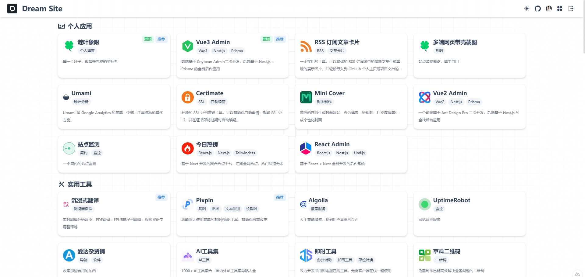
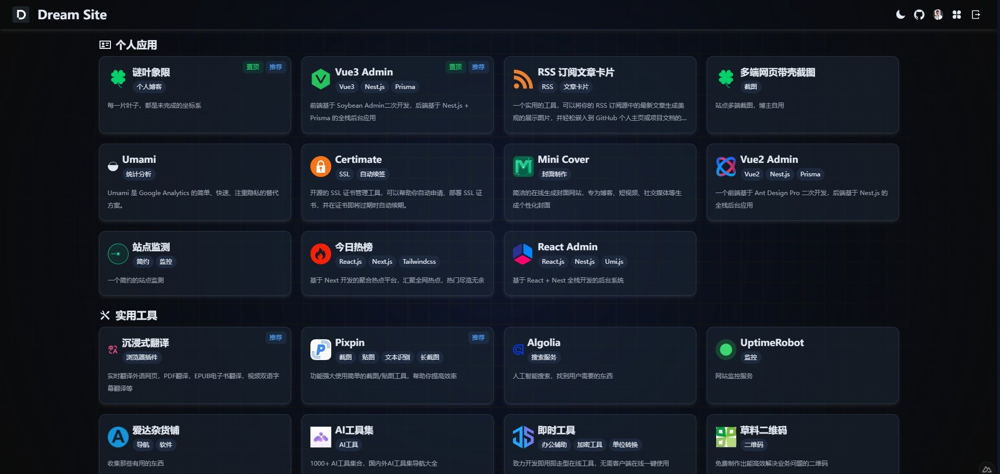
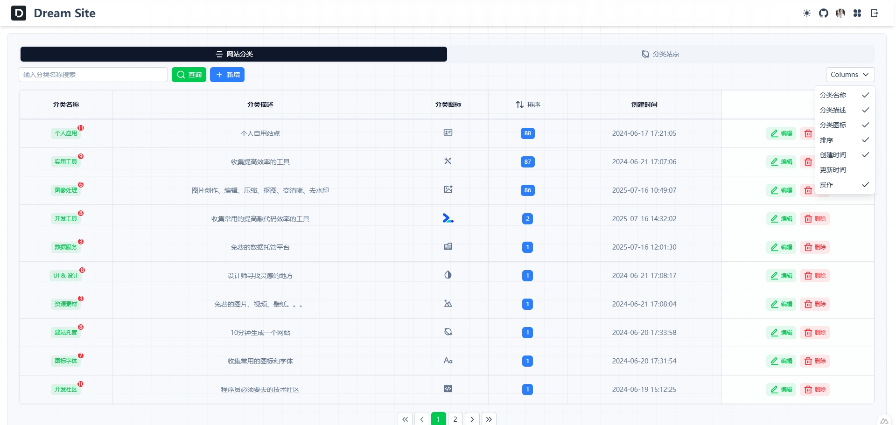
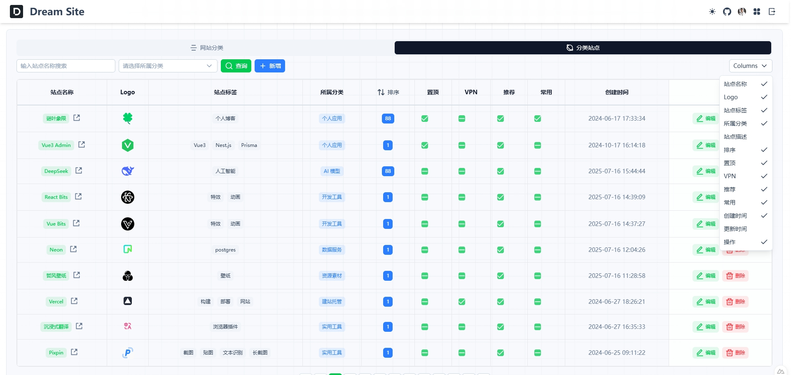

<div align="center">

<h2>拾光导航 · nav-station</h2>
<p>一个简约、精美、现代化的个人站点导航</p>
</div>

<div align="center">
  <a href="https://vercel.com" target="_blank">
    
  </a>
  <a href="https://nuxt.com/" target="_blank">
    
  </a>
  <a href="https://supabase.com/" target="_blank">
    
  </a>
  <a href="https://tailwindcss.com/" target="_blank">
    
  </a>
  <a href="./LICENSE" target="_blank">
    
  </a>
</div>

## ☘️ 项目简介

`拾光导航（nav-station）` 是一个轻量、简洁的个人站点导航系统，旨在为用户提供美观、高效的个人网站收藏与管理体验。无论你是开发者、设计师还是内容创作者，都可以用它来组织和展示你喜爱的网站资源。

## 🌿 在线体验

➡️ [点击打开](https://github.com/chendada00/nav)

## 🪴 技术栈

- **前端框架**: [Nuxt 4.0](https://nuxt.com/) (基于Vue 3)
- **UI组件**: [NuxtUI](https://ui.nuxt.com/)
- **样式方案**: [Tailwind CSS](https://www.tailwindcss.cn/)
- **后端服务**: [Supabase](https://supabase.com/) (开源Firebase替代品)
- **部署平台**: 支持 `Vercel` 等多种部署方式

## ✨ 特性
- 🚀 **高性能**: 基于最新前端技术栈，极速响应
- 🌓 **主题切换**: 完善的亮色/暗黑模式支持
- 🔍 **SEO友好**: 支持SSR渲染，优化搜索引擎收录
- 📱 **响应式设计**: 适配各种设备屏幕
- 🔒 **安全认证**: 基于Supabase的完整用户系统
- 🧩 **模块化架构**: 清晰的目录结构，便于二次开发

## 🪴 项目截图

| 亮色模式 | 暗色模式 |
|----------|----------|
|  |  |

| 分类管理 | 站点列表 |
|----------|----------|
|  |  |

## 🚀 快速开始

### 🌳 环境要求
- Node.js ≥ 20.19（推荐 Node.js 22 LTS）
- pnpm (推荐) 或 npm/yarn

### 🧑‍💻 本地开发
```bash
# 克隆项目
git clone https://github.com/chendada00/nav.git

# 进入项目目录
cd nav

# 安装依赖
pnpm install

# 启动开发服务器
pnpm dev
```

### 📝 初始化数据库
1. 进入 [supabase 控制台](https://supabase.com/dashboard)，创建项目，并获取`SUPABASE_URL`和`SUPABASE_KEY`
2. 导入数据库结构，将 `initSupabase.sql` 导入到 `Supabase SQL` 编辑器中执行。
3. 在根目录下创建`.env`文件，并添加以下内容：
```env
SUPABASE_URL="xxx"
SUPABASE_KEY="xxx"
```
4. 进入 `Authentication` ，自行配置 `Policies` 和 `Sign In / Providers`

## ⚙️ Vercel 一键部署
1. `Fork` 本项目，在 `Vercel` 官网点击 `New Project`
2. 点击 `Import Git Repository` 并选择你 fork 的此项目并点击 `import`
3. `PROJECT NAME`自己填，`FRAMEWORK PRESET` 选 `Other` 然后直接点 `Deploy` 接着等部署完成即可

<a href="https://vercel.com/dashboard" target="_blank">

</a>

## 📜 许可证
本项目采用 [MIT](LICENSE) 许可证。

## ⭐ Star History

[](https://star-history.com/#chendada00/nav&Date)

## 轻量化版本说明

拾光导航（nav-station）保留首页导航、分类/站点数据、Supabase 数据库、后台管理、登录/注册、OAuth 回调及原有管理 API。为降低首屏和运行时负担，首页不再启动持续运行的 WebGL 鼠标流体和 Canvas 背景动画；分类标题和站点卡片改为轻量 DOM 展示，卡片 hover 样式仍保留。首页新增专用 `/api/home` 只读取展示需要的字段，不影响后台使用的完整分类/站点 API。

### 环境变量

1. 复制 `.env.example` 为 `.env`（本地开发），填写 Supabase 项目的 URL 和 anon/public key。
2. 部署平台的 Environment Variables 中配置相同变量，并将 `NUXT_SITE_URL` 设置为实际站点 HTTPS 地址。
3. Supabase Auth 的 Site URL / Redirect URLs 中加入实际域名及 `/confirm` 回调路径；OAuth 提供商也需要配置对应回调地址。

`initSupabase.sql` 已附加可选索引。已有数据库无需重建表；如需优化数据库查询，可在 Supabase SQL Editor 中单独执行新增的 `CREATE INDEX IF NOT EXISTS` 语句。

### 本地检查

```bash
pnpm install --frozen-lockfile
pnpm build
pnpm preview  # 直接启动 .output/server/index.mjs
```

> 当前交付环境无法访问 npm registry，因此无法在此环境执行依赖安装和真实生产构建。请在可联网的本地环境或 CI 中运行上述命令，并在部署后验证登录、后台 CRUD 和首页数据。

### 生产预览与图片处理

`pnpm preview` 直接运行 `node .output/server/index.mjs`，绕过某些 Nuxt CLI 版本在预览模式下对 `{{ output.serverDir }}` 的错误展开。若本地仍出现 `sharp-emscripten-wasm32.node.wasm` 缺失，请删除 `.output` 后重新构建，并执行 `pnpm install --force` 后再运行 `pnpm build`；这类报错通常是本机依赖/可选二进制安装不完整。运行时 OG 图片生成已关闭，避免额外的图片渲染开销。
